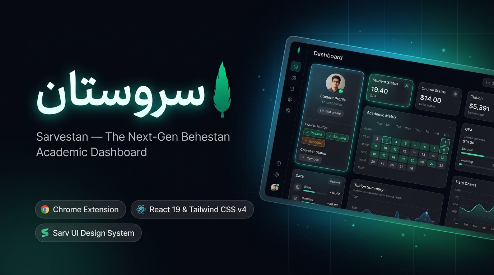

<div align="center">

# 

# سروستان | Sarvestan

### اکوسیستم نسل جدید، هوشمند و مینیمال برای سامانه آموزشی بهستان و گلستان
**نگارش رسمی ۲.۰.۰ (تهران)**

<br/>

[](https://mjb4khshi.github.io/sarvestan/)
[-0284c7?style=for-the-badge&logo=android&logoColor=white)](https://github.com/mjb4khshi/sarvestan/releases/latest/download/sarvestan.apk)
[-22c55e?style=for-the-badge&logo=github&logoColor=white)](https://github.com/mjb4khshi/sarvestan/releases/latest)

<br/>

[](https://react.dev)
[](https://developer.android.com)
[](https://capacitorjs.com)
[](https://tailwindcss.com)
[](https://github.com/mjb4khshi/sarv-ui)
[](LICENSE)

<br/>

**سروستان** یک اکوسیستم آزاد، مدرن و مستقل است که سامانه‌های آموزشی دانشگاهی (بهستان و گلستان) را به محیطی سریع، بصری و امن با زبان طراحی اختصاصی **Sarv UI** تبدیل می‌کند. سروستان نگارش ۲ (تهران) هم‌اکنون به صورت اپلیکیشن اندروید و وب‌اپلیکیشن مستقل در دسترس دانشجویان است.

</div>

---

## دانشگاه‌های تحت پوشش

| دانشگاه | وضعیت پشتیبانی | سامانه آموزشی مبدا |
| :--- | :---: | :--- |
| **دانشگاه صنعتی خواجه نصیرالدین طوسی** | پشتیبانی کامل (فعال) | گلستان / بهستان دانشکده‌ها |
| **دانشگاه شهید بهشتی** | پشتیبانی کامل (فعال) | بهستان دانشگاه |
| **دانشگاه تهران** | پشتیبانی کامل (فعال) | بهستان جامع |
| **دانشگاه صنعتی امیرکبیر (پلی‌تکنیک)** | پشتیبانی کامل (فعال) | بهستان دانشگاه |
| **دانشگاه علم و صنعت ایران** | به زودی (در حال توسعه) | گلستان |
| **دانشگاه تربیت دبیر شهید رجایی** | به زودی (در حال توسعه) | گلستان |

---

## شورای هماهنگی سروستان

شورای هماهنگی سروستان متشکل از دانشجویان دانشگاه‌های همکار جهت ارتقا، همفکری و گسترش زیست‌بوم آموزشی سروستان در سطح دانشگاه‌های کشور است:

* **محمدجواد بخشی ایرج**: دبیر شورا و توسعه‌دهنده اصلی (دانشگاه صنعتی خواجه نصیرالدین طوسی)
* **سید محمدحسین حائری**: هماهنگ‌کننده و پشتیبانی شورا (دانشگاه صنعتی خواجه نصیرالدین طوسی)
* **امیرحسن رضایی**: نماینده شورا (دانشگاه صنعتی امیرکبیر)
* **محمدحسین شفیعی**: نماینده شورا (دانشگاه تهران)
* **محمدسجاد زنگنه**: نماینده شورا (دانشگاه شهید بهشتی)
* **مهدی خسروی**: نماینده شورا (دانشگاه تربیت دبیر شهید رجایی)
* **محمدرضا اسفندیار**: نماینده شورا (دانشگاه علم و صنعت ایران)

---

## امکانات و قابلیت‌ها

| بخش | امکانات و ویژگی‌ها |
| :--- | :--- |
| **میز کار تحصیلی (Overview)** | نمایش خلاصه وضعیت، معدل کل، واحدهای گذرانده، تراز مالی، کلاس‌های روز و دسترسی سریع |
| **پشتیبانی دانشجویان کهاد** | همگام‌سازی و تفکیک دروس دانشجویان دورشته‌ای بدون تداخل برنامه |
| **یادآورها و حالت سکوت (DND)** | بی‌صدا شدن خودکار گوشی حین کلاس و یادآور هفتگی رزرو غذای سماد |
| **ویرایش و شخصی‌سازی دروس** | ویرایش نام استاد، شماره کلاس، ساعت و رنگ کارت‌ها با امکان بازگشت به سامانه مبدا |
| **کارنامه و نمرات (Transcripts)** | ریزنمرات تمام ترم‌ها، محاسبه آنلاین معدل ترمی و تجمعی، فیلتر درس‌ها و درصد قبولی |
| **برنامه هفتگی و امتحانات** | تقویم بصری ماتریسی، خروجی تقویم موبایل، کارت آزمون و پنج‌شنبه پویا |
| **ویجت‌های زنده هوم‌اسکرین** | ۳ ویجت اختصاصی اندروید (کلاس بعدی، معدل تحصیلی و کامبو ترکیبی) با آپدیت خودکار |
| **پوسته‌ها و آیکون‌های داینامیک** | ۱۵ تم رنگی بر پایه Sarv UI در وب + ۱۲ پوسته اختصاصی آیکون لانچر در اندروید |
| **امور مالی و شهریه (Finance)** | صورتحساب ریزتراز، بدهی و بستانکاری و ارجاع امن به درگاه‌های پرداخت شتاب |
| **چارت و وضعیت دروس** | دسته‌بندی هوشمند دروس (پایه، تخصصی، عمومی، اختیاری) و نشان‌های رنگی وضعیت |
| **کانال‌ها و شعرنامه (سرونامه)** | محیط اشتراک محتوای فرهنگی و اطلاعیه‌های رسمی با پشتیبانی از مارک‌داون |
| **خروجی امن کارنامه و برنامه** | تولید تصاویر باکیفیت و استوری بدون افشای کد دانشجویی یا اطلاعات حساس |

---

## راهنمای دریافت و نصب

### نصب اپلیکیشن اندروید (APK)
1. آخرین فایل نصبی را مستقیماً از **[ریلیزهای رسمی گیت‌هاب](https://github.com/mjb4khshi/sarvestan/releases/latest/download/sarvestan.apk)** دریافت کنید.
2. در صورت مشاهده پیام امنیتی اندروید برای فایل‌های خارج از استور، مجوز **Allow from this source** را فعال کنید.
3. برنامه را باز کرده و با انتخاب دانشگاه و ورود اطلاعات دانشجویی، از تجربه کاربری سریع و ۱۰۰٪ آفلاین لذت ببرید.
4. با نگه‌داشتن انگشت روی صفحه اصلی گوشی (Home Screen)، ویجت‌های کلاسی و تحصیلی سروستان را اضافه نمایید.

---

## امنیت و حریم خصوصی

* **پردازش کاملاً محلی (Client-Side Only):** تمامی درخواست‌ها و پردازش‌ها مستقیماً در دستگاه کاربر انجام می‌شوند و هیچ سرور واسطه یا شخص ثالثی وجود ندارد.
* **عدم ارسال اطلاعات هویتی:** رمز عبور، شماره دانشجویی و نشست‌ها در هیچ سروری خارج از دستگاه ذخیره یا مخابره نمی‌شوند.
* **پرداخت در بستر رسمی:** کلیه امور پرداخت شهریه مستقیماً و از طریق پروتکل رسمی سامانه دانشگاه به درگاه‌های شاپرک هدایت می‌شوند.
* **اشتراک‌گذاری هوشمند:** در خروجی‌های تصویری و استوری، شماره دانشجویی به صورت خودکار حذف می‌گردد تا حریم خصوصی دانشجو حفظ شود.

---

## معماری و ساختار پروژه

```text
sarvestan/
├── public/                     # آیکون‌ها، نشان دانشگاه‌ها و فایل‌های استاتیک
├── src/
│   ├── components/             # لندینگ پیج، مودال‌ها و ویجت‌های مشترک
│   ├── modules/                # ماژول‌های اصلی (Overview, Transcripts, Schedule, Finance, ...)
│   └── services/               # پارسرهای ساختار بهستان و گلستان، کش محلی و ذخیره‌سازی آفلاین
├── sarvestan-android/          # پروژه اختصاصی اپلیکیشن اندروید (Capacitor + React)
│   ├── android/app/src/main/   # کدهای نیتیو جاوا (ویجت‌های هوم‌اسکرین و پلاگین آیکون)
│   └── src/screens/            # صفحات ویژه موبایل و تنظیمات پیشرفته
```

### اجرای پروژه در محیط توسعه (Local Setup):
```bash
# نصب وابستگی‌ها
npm install

# اجرای وب‌سرور توسعه
npm run dev

# بیلد نسخه پروداکشن
npm run build
```

---

## قدردانی و همراهان

با تشکر صمیمانه از **اشکان جلالی** بابت همراهی و مشاوره‌های فنی، و تسترها و حامیان نسخه بتا: سید محمدحسین حائری، پارسا شکیبایی، حسام خانی، محمدحسین صفدری، امیر صالحی و صدرا زینال زاده.

---

## مجوز (License)

این پروژه تحت مجوز متن‌باز [MIT](LICENSE) منتشر شده است.

---

<div align="center">
  <a href="https://github.com/mjb4khshi">
    
  </a>
  <br/>
  <br/>
  <b>طراحی و توسعه توسط</b><br/>
  <a href="https://github.com/mjb4khshi"><strong>محمدجواد بخشی ایرج (@mjb4khshi)</strong></a><br/>
  <span style="font-size: 12px; opacity: 0.8;">دبیر شورای هماهنگی سروستان • دانشگاه صنعتی خواجه نصیرالدین طوسی</span>
  <br/>
  <br/>
  <a href="https://github.com/mjb4khshi">گیت‌هاب</a> •
  <a href="https://www.linkedin.com/in/mjbakhshi/">لینکدین</a> •
  <a href="https://github.com/mjb4khshi/sarv-ui">Sarv UI</a>
</div>
